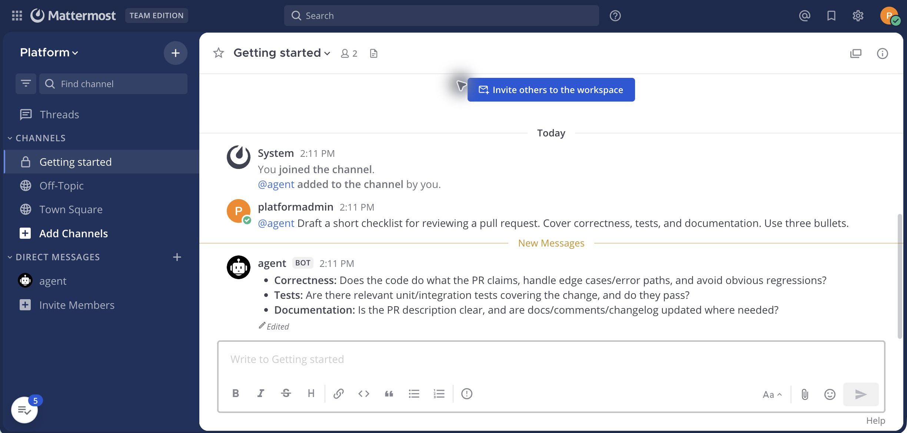

# Octogee Cloud

Run AI agents for multiple users, with chat, Git repositories, and access to
AI models. Octogee Cloud combines OpenClaw, Mattermost, and Gitea into a
platform you can host and manage.

Each user gets a chat account and a place to keep their agent's work. Users
message their agents in Mattermost and work with files in Gitea. Operators
assign users to shared infrastructure or a dedicated gateway and move
them between the two as their needs change.

**[Try it locally](docs/getting-started.md) ·
[Run the full platform](docs/kind.md) ·
[Contribute](CONTRIBUTING.md)**

An agent conversation from the [GKE installation walkthrough](docs/running-in-the-cloud.md),
using Meta Muse Ember through OpenRouter. Click any screenshot to enlarge it.

## How it works

- **OpenClaw runs the agents.** An agent combines an AI model with tools to
  carry out tasks. A gateway is the service that runs agents and connects them
  to chat and tools.
- **Mattermost provides chat.** Users send messages, receive replies, and
  collaborate in channels.
- **Gitea stores work.** Each user gets an organization with a workspace
  repository for files and version history.
- **Octogee Cloud manages the fleet.** The fleet controller assigns users to
  gateways, moves them between gateways, and coordinates updates. A model
  broker connects agents to AI providers and records usage.

Shared gateways serve multiple users through platform-controlled tools.
Isolated gateways give one user shell tools and the OpenClaw Control UI in a
dedicated environment. Operators manage both with the
[`octogee-fleet`](https://github.com/octogee-ai/octogee-fleet) command line.
Read the [architecture guide](docs/architecture.md),
[trust boundaries](docs/why-octogee-cloud.md), and
[Admin API automation guide](docs/admin-api-automation.md).

## Choose a starting point

| What you want to do | Start here | What you get |
| --- | --- | --- |
| Talk to an agent on your machine | [Local foundation](docs/getting-started.md) | One OpenClaw gateway, Mattermost, and Gitea in Docker |
| Explore user management and shared gateways | [Full platform on kind](docs/kind.md) | The fleet controller, platform API, model broker, chat, and Git on a local Kubernetes cluster |
| Install the foundation on Google Cloud or AWS | [Cloud installation](docs/running-in-the-cloud.md) | One gateway, chat, and Git on GKE or EKS with managed storage |
| Run the full platform in a cloud account | [GKE](docs/gke.md) or [EKS](docs/eks.md) | Fleet management, user accounts, model access, chat, and Git with managed storage |
| Improve the code or documentation | [Contributing](CONTRIBUTING.md) | Local package checks and a guide to your first pull request |

The local foundation needs Docker and a model provider API key for agent
replies. The full platform uses [kind](https://kind.sigs.k8s.io/), which runs
Kubernetes in Docker; allow at least 8 CPUs and 12 GB of memory for Docker.
See [requirements](docs/requirements.md) for tools and
[the installation guide](docs/getting-started.md#what-you-need-to-sign-up-for)
for accounts and model access.

For published builds, start from the
[latest release](https://github.com/octogee-ai/octogee-cloud/releases/latest)
and follow the guide included in that checkout.
[Releasing](docs/releasing.md) explains image, chart, and package versions.

## Find your way around

| Location | Purpose |
| --- | --- |
| [`core/`](core/), [`core-testing/`](core-testing/), [`shared/`](shared/) | Shared runtime, platform state, and types |
| [`fleet-controller/`](fleet-controller/) | Fleet controller and administration API |
| [`platform-api/`](platform-api/), [`llm-broker/`](llm-broker/), [`gateway-edge/`](gateway-edge/) | Platform API, model access, and gateway routing |
| [`deploy/`](deploy/), [`gateway/`](gateway/), [`desktop/`](desktop/), [`charts/`](charts/), [`terraform/`](terraform/) | Installers, images, and infrastructure |
| [`gateway-supervisor/`](gateway-supervisor/), [`provisioning-service/`](provisioning-service/) | Gateway lifecycle and account provisioning |
| [`scripts/`](scripts/), [`tests/`](tests/) | Operations, build tooling, and cross-package tests |
| [`templates/`](templates/) | Starter files for agents and workspaces |
| [`docs/`](docs/), [`AGENTS.md`](AGENTS.md) | Guides, engineering conventions, and agent instructions |

## Contribute

Documentation improvements, bug reports, and code changes are welcome. You can
run package tests with Node.js 24 and npm, without a cloud account or model key.
[Contributing](CONTRIBUTING.md) walks through setup, checks, and commit sign-off.
Our [code of conduct](CODE_OF_CONDUCT.md) applies in project spaces.

## Security and published images

Use the [security policy](SECURITY.md) to report vulnerabilities privately.
The [OpenClaw compatibility guide](docs/openclaw-compatibility.md) records the
build and patches used by the fleet image.

[Build main](https://github.com/octogee-ai/octogee-cloud/actions/workflows/build-main.yml)
publishes image manifests, vulnerability reports, and software bills of
materials. [Verify published images](docs/kind.md#verify-published-images)
explains how to check their provenance. The
[source](https://github.com/octogee-ai/octogee-cloud/actions/workflows/source-security.yml)
and [image](https://github.com/octogee-ai/octogee-cloud/actions/workflows/image-security.yml)
security workflows run recurring scans.

## License

[MIT](LICENSE).
