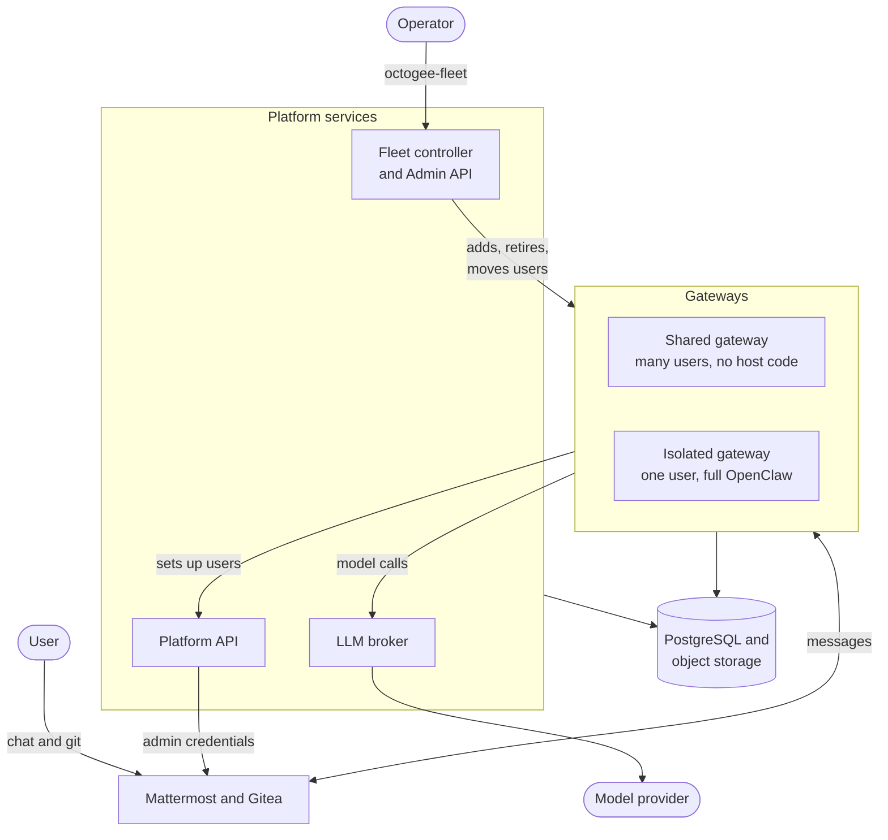
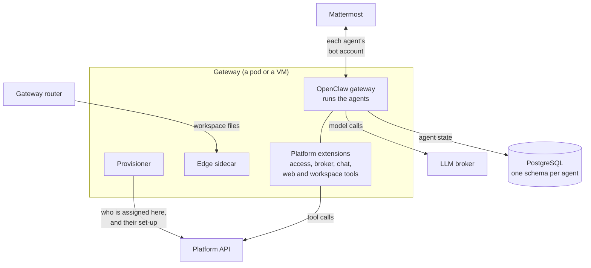
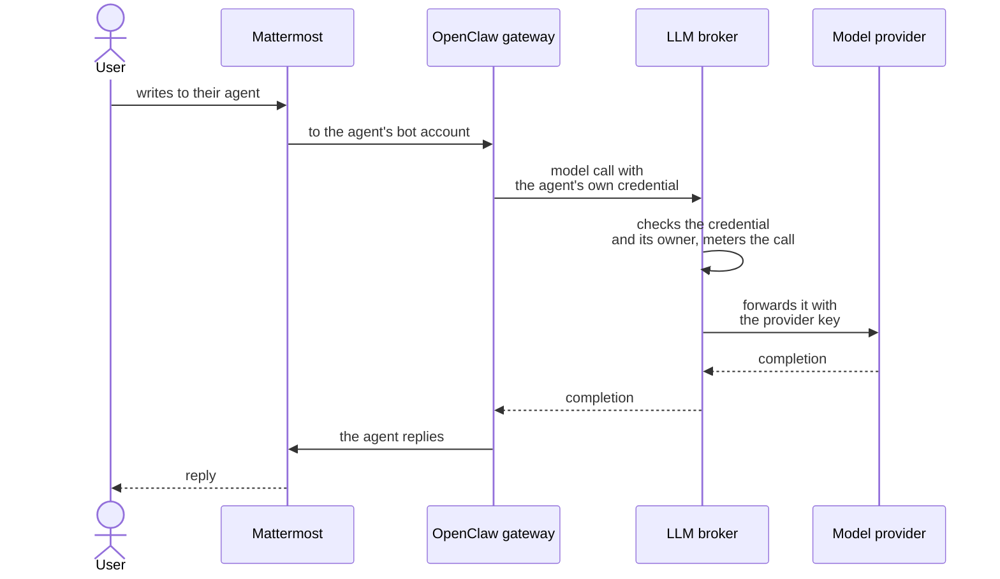
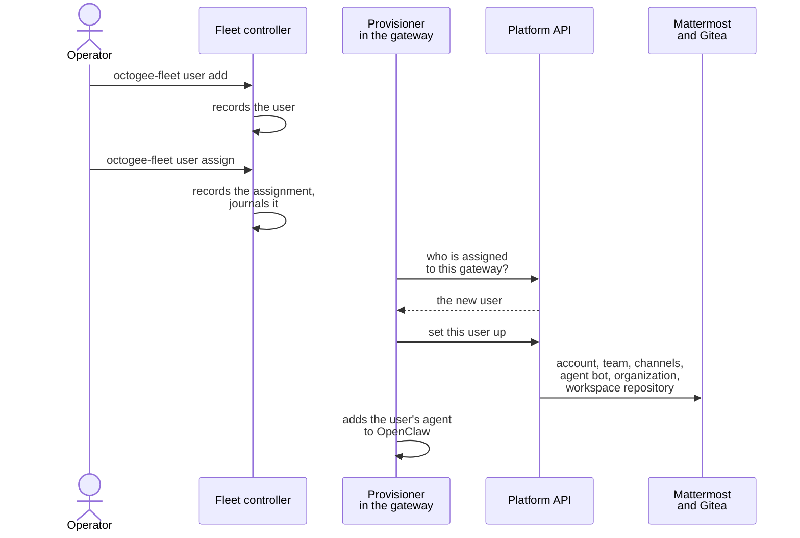
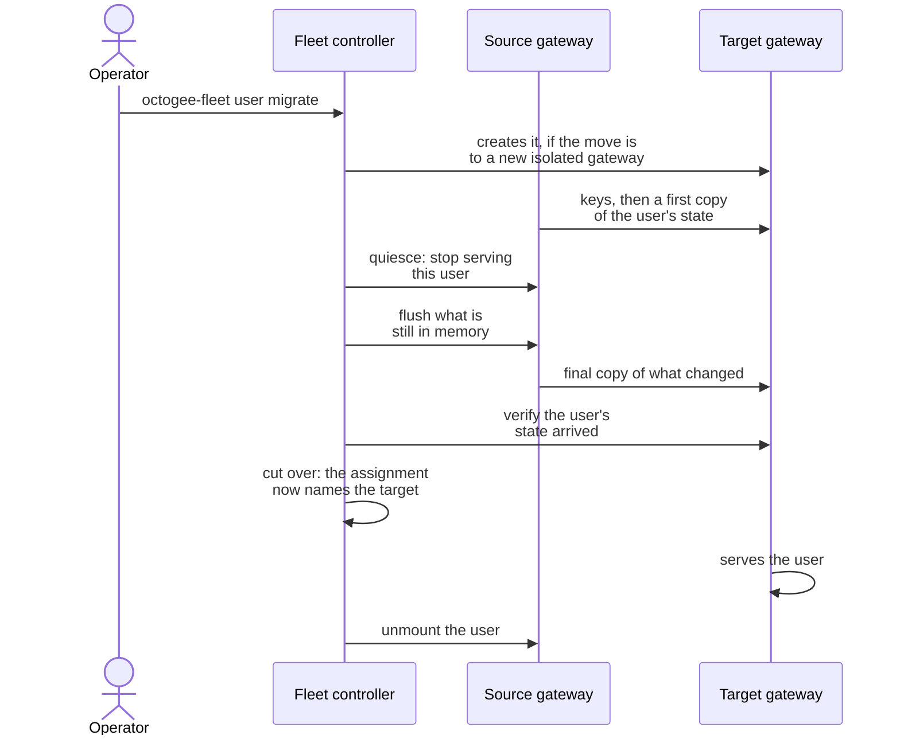

# Octogee Cloud

[](https://github.com/octogee-ai/octogee-cloud/actions/workflows/checks.yml)
[](https://github.com/octogee-ai/octogee-cloud/actions/workflows/build-main.yml)
[](LICENSE)

Octogee Cloud runs [OpenClaw](https://openclaw.ai) agents for many users on
Kubernetes. Each user gets an agent, a Mattermost team for chat and a Gitea
organization for git. A fleet controller places users on shared gateways,
where people who do not know each other share one OpenClaw gateway and host
code is denied, or on an isolated gateway of their own, and moves them between
the two. Brokers hold the model keys and other credentials, so a gateway holds
none.

It is the open platform under [Octogee](https://octogee.com), and it is also
the software factory that builds it: the files my agents load at the start of
every session, the checks they run before a change reaches `main`, and the
commands that ship a build. You can read the factory yourself instead of
taking my word for it.

- [Architecture](docs/architecture.md): the services, where state lives, and
  how a product builds on top.
- [How this differs from OpenClaw Enterprise](docs/why-octogee-cloud.md): the
  trust model.
- [Known rough edges](docs/rough-edges.md): what I would change, said before
  you find it.

## The platform at a glance



An operator runs the fleet from the command line. Users never touch the
platform directly: they talk to their agent in Mattermost and keep their work
in Gitea. Gateways run the agents and hold no keys. [How it works](#how-it-works)
has the components and three walkthroughs.

## Run it

```bash
curl -fsSLo install.sh https://raw.githubusercontent.com/octogee-ai/octogee-cloud/main/install.sh
# Review install.sh before running it.
bash install.sh
```

`install.sh` sets up the foundation: Gitea, Mattermost and one stock OpenClaw
gateway, [on your machine](docs/getting-started.md) or [on GKE or EKS](docs/running-in-the-cloud.md).
It does not install the fleet controller, the platform API or the LLM broker.

The full platform, with the fleet controller, users and shared gateways, runs
from the images this repository publishes on a local kind cluster, see
[The full platform on kind](docs/kind.md), or on GKE with Cloud SQL and Cloud
Storage, see [The full platform on GKE](docs/gke.md). Start from the
[latest release](https://github.com/octogee-ai/octogee-cloud/releases/latest),
which publishes the images, the Helm charts and the `@octogee/core` and
`@octogee/shared` npm packages at one version (see [Releasing](docs/releasing.md));
until the first one is out, from `main`'s newest commit whose Build main
succeeded, as both guides describe. Platform state is in PostgreSQL, and the
platform needs no Firebase project. An EKS install with RDS and S3,
[The full platform on EKS](docs/eks.md), follows the GKE one but has not run on
a real AWS account yet. On GKE, one install
added a shared gateway and a user, answered in Mattermost, moved the user to an
isolated gateway and back, and retired the isolated gateway. That install is a
single zone with no ingress; there is no production install guide yet. Users on a shared
gateway work through Mattermost and Gitea; the OpenClaw Control UI is for
isolated gateways only. The platform API knows a user by their Mattermost
session or personal access token; see
[Call the platform API as a user](docs/kind.md#call-the-platform-api-as-a-user).

Some features start switched off, among them agent import and export, the
OpenClaw dashboard, project repository sources and voice. List the ones you
want in the chart value `octogee-api.featureFlags.enabled`, using the keys in
[`shared/types/feature-flags.ts`](shared/types/feature-flags.ts). An unknown
key stops the platform API at startup.

## What you need to sign up for

For `install.sh` on your own machine, one model key; Gemini's free tier works
there, but not on the full platform. On Google Cloud, also a billing account
and a domain. [See every account and tier](docs/getting-started.md#what-you-need-to-sign-up-for).

## How it works

### The components

| Component | Directory | What it does |
| --- | --- | --- |
| Fleet controller | `glm-controller/` | Owns which gateways exist and which user is on which. Serves the Admin API, installs gateways with Helm, moves users, and journals every change. |
| Platform API | `octogee-api/` | Serves most HTTP routes. Its fleet broker holds the Mattermost and Gitea admin credentials, and it issues each agent its model credential. |
| LLM broker | `octogee-api/` | Holds the model provider keys and meters every call. |
| Edge | `gateway-edge/` | A sidecar in each gateway pod that serves the user's workspace files, and the gateway router that sends `/g/<gatewayId>/*` to the right sidecar. |
| Provisioner | `scripts/` | Runs in every gateway. Sets up each user assigned to it: chat account, team, channels, agent bot, git organization and repository. |
| Gateway image | `infra/gateway/` | OpenClaw, the provisioner and the platform's OpenClaw extensions. |

### Inside a gateway



A gateway asks for everything and is trusted with nothing. Its calls are
authenticated as that gateway, and the platform checks which gateway is asking
and which user it serves before it answers. On a shared gateway the agents also cannot run host code, which is
what lets people who do not know each other share one OpenClaw process.

### A message, end to end



The provider key never leaves the broker. The gateway holds a credential that
is good for one agent and that the platform can revoke.

### Adding a user



Nothing happens until the operator assigns the user. The platform places
nobody by itself.

### Moving a user between gateways



A user's agents, channels, repositories, agent stores and schedules are records
the fleet controller owns, which is what makes the move possible. The source
stops before the final copy, so one gateway serves the user at a time. Each
phase is recorded, so an interrupted move continues from where it stopped.

[Architecture](docs/architecture.md) goes further: where every kind of state
lives, who authenticates how, the parts an install can replace, and how a
product builds on top.

## What is here

- `AGENTS.md` is the contract every agent loads.
- `docs/handbook/` holds the Dev Workflow chapters of the handbook.
- The platform packages: `core`, `shared`, `fleet-controller`, `gateway-edge`
  and `platform-api`; the images in `gateway`, `desktop` and `vm-bridge`; with
  `charts`, `terraform`, `templates` and `scripts` beside them. `tests/` holds the
  cross-package platform specs.
- [Legacy names](docs/legacy-names.md) lists the stored names that keep
  their spelling from before the platform was published.

The Octogee product keeps its own private repository and builds on top of this
one.

## Contributing and security

[Contributing](CONTRIBUTING.md) explains how to run checks and sign off commits,
and [Releasing](docs/releasing.md) how a release is cut.
Pull requests run dependency review, lint, typechecks, and package tests.
Use the [security policy](SECURITY.md) to report vulnerabilities privately.

Open [Build main](https://github.com/octogee-ai/octogee-cloud/actions/workflows/build-main.yml)
for the image manifest, Trivy reports, and CycloneDX SBOMs for both Linux
architectures. The [Image security workflow](https://github.com/octogee-ai/octogee-cloud/actions/workflows/image-security.yml)
rescans the latest published main build weekly. See [Verify published images](docs/kind.md#verify-published-images)
for provenance and [Source security](https://github.com/octogee-ai/octogee-cloud/actions/workflows/source-security.yml)
for lockfile, infrastructure, and workflow scans.

## License

MIT. See `LICENSE`.
