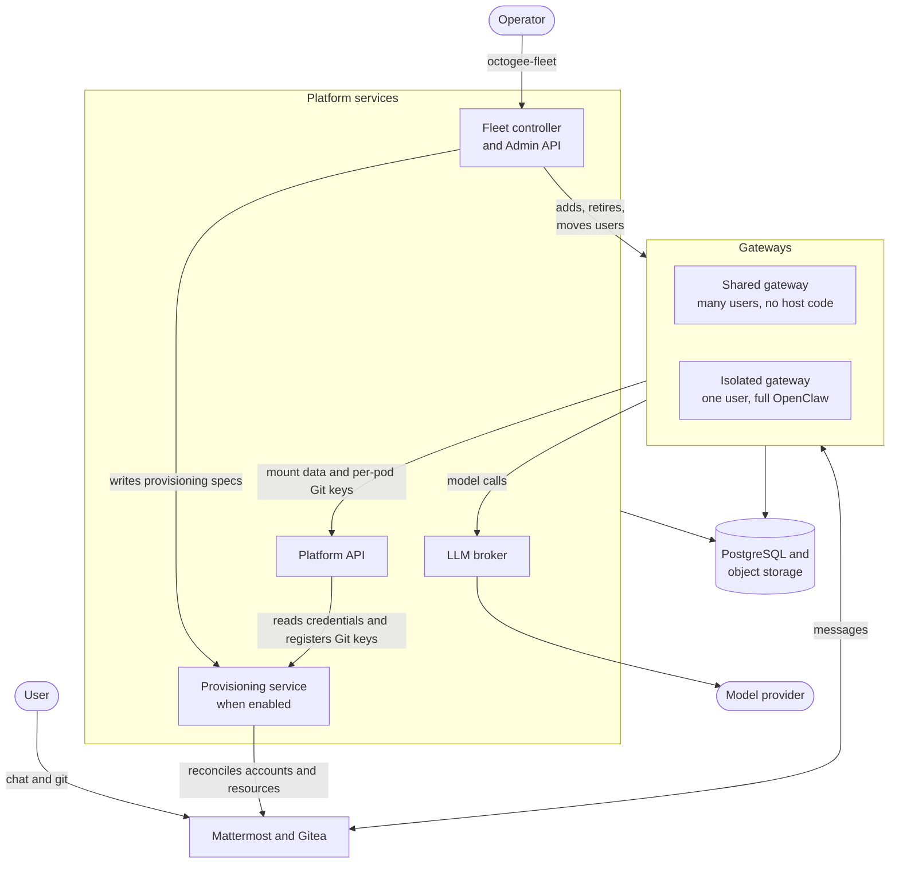
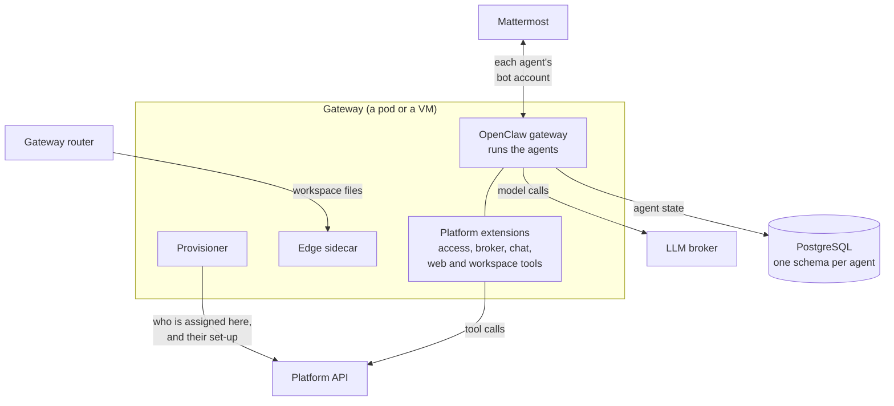
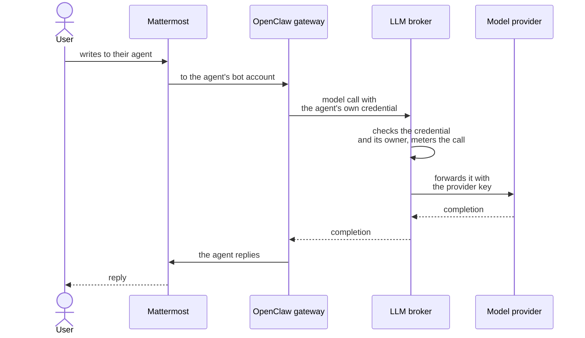
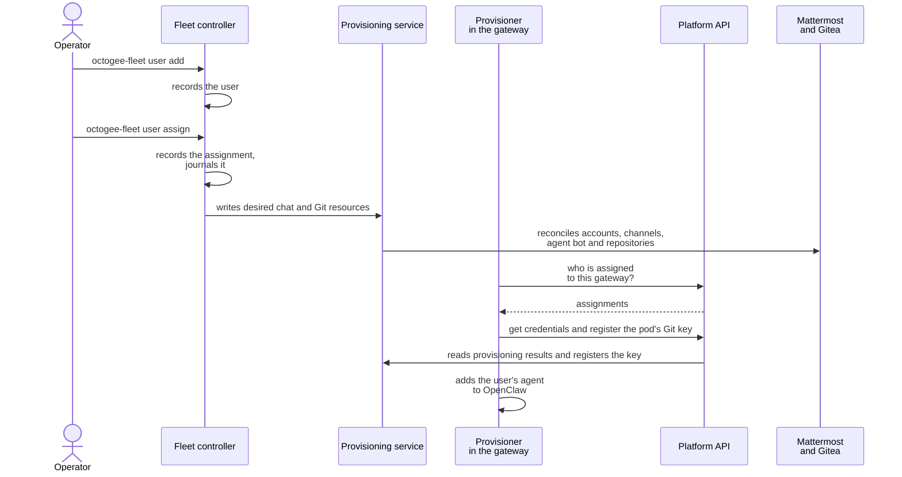
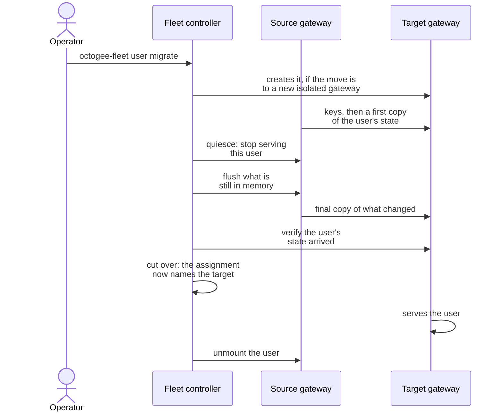

# Architecture

What runs, who talks to whom, where state lives, and how a product builds on
top. [Why octogee-cloud](why-octogee-cloud.md) covers the trust model.

## The picture

### Inside a gateway

The platform authenticates gateway calls and checks which user the gateway
serves before answering. Shared gateways enforce host execution restrictions
so independent users can share an OpenClaw process.

### A message, end to end

The provider key never leaves the broker. The gateway holds a credential that
is good for one agent and that the platform can revoke.

### Adding a user

With the provisioning service enabled, the fleet controller writes the user's
desired resources when it admits the user and assigns a serving gateway.

An operator can assign the user manually. A product can drive placement and
migrations through the [Admin API](admin-api-automation.md).

### Moving a user between gateways

A user's agents, channels, repositories, agent stores and schedules are records
the fleet controller owns, which is what makes the move possible. The source
stops before the final copy, so one gateway serves the user at a time. Each
phase is recorded, so an interrupted move continues from where it stopped.

## Services

| Service | Directory | Runs as | What it does |
| --- | --- | --- | --- |
| Fleet controller | [`fleet-controller/`](../fleet-controller/README.md) | Deployment `glm-controller` | Owns the fleet: which gateways exist, which user is on which, and every move between them. Serves the Admin API that [`octogee-fleet`](https://github.com/octogee-ai/octogee-fleet) calls. Installs gateways with Helm, and creates the virtual machine when an isolated gateway runs on one. Writes an operations-journal entry for every change it makes. |
| Platform API | `platform-api/` | Deployment `octogee-api` | Serves most HTTP routes and brokers chat credentials and per-pod Git keys for gateways. |
| Provisioning service | [`provisioning-service/`](../provisioning-service/README.md) | Deployment `provisioning-service`, when enabled | Reconciles chat and Git resources from specs written by the fleet controller. Adopts an existing bot by its recorded ID, issues chat credentials and manages per-pod Git keys. |
| LLM broker | `llm-broker/` | Deployment `llm-broker`, from the `llm-broker` image | Holds the model provider keys and meters every call. An agent calls it with a credential the platform issued to that agent. |
| npm cache proxy | `platform-api/` (`src/npm-cache-proxy.ts`) | Deployment `octogee-npm-cache-proxy` | An npm registry proxy with a cache. |
| Edge | `gateway-edge/` | Container `gateway-edge` in each gateway pod; Deployments `gateway-router` and `mattermost-callback-router` | One codebase, three roles. As a sidecar in each gateway pod it serves the user's workspace files and proxies the Mattermost WebSocket. As the gateway router it sends `/g/<gatewayId>/*` to that gateway's sidecar. As the Mattermost callback router it receives Mattermost's callbacks. |
| Gateway image | [`gateway/`](../gateway/README.md) | Container `gateway` in each gateway pod, one Helm release of `charts/octogee-gateway` per gateway | OpenClaw, the gateway supervisor, and the platform's OpenClaw extensions under `gateway/extensions/platform/`. [OpenClaw compatibility](openclaw-compatibility.md) lists the patches the OpenClaw build carries. |
| Gateway supervisor | [`gateway-supervisor/`](../gateway-supervisor/README.md) | Boot steps and runners in the `gateway` container, installed at `/octogee/scripts` | The pod's boot steps, the runners that supervise OpenClaw and set up each user, and the VM agent. Its README lists each entrypoint and what starts it. |
| Provisioner | [`gateway-supervisor/entrypoints/provisioner.ts`](../gateway-supervisor/README.md#the-provisioner) | A process in the `gateway` container | Mounts assigned users, configures OpenClaw and registers each pod's Git key through the platform API. When the provisioning service is disabled, it also requests chat and Git setup through the fleet broker. |
| VM agent | [`gateway-supervisor/entrypoints/vm-gateway-agent.ts`](../gateway-supervisor/entrypoints/vm-gateway-agent.ts) | A container on an isolated gateway's virtual machine, run from the gateway image | Mounts the VM's home disk, starts the gateway container and reports to the platform API. |
| Isolated gateway VM image | [`desktop/`](../desktop/README.md) | A Google Cloud virtual machine | The virtual machine image for an isolated gateway that runs on a VM, which adds a desktop. Google Cloud only today. |
| VM bridge | [`vm-bridge/`](../vm-bridge/README.md) | Deployment `octogee-vm-bridge` | A TCP proxy through which a gateway on a virtual machine reaches the platform API, the LLM broker, the npm cache proxy, Mattermost and Gitea. Installed only when `global.computer.enabled` is set. |

The names under "Runs as" are what `kubectl` shows. Two of them,
`glm-controller` and `octogee-api`, are from before the directories were
renamed, and the images, service accounts and chart values keys of those two
services use them too. [Legacy names](legacy-names.md) lists every name that
keeps an earlier spelling, and the directory names a v0.1.0 checkout has.

Each linked directory has a README that says what the component is
responsible for, how it runs, what it talks to, how it is configured and how
to build and test it on its own.

[`core/`](../core/README.md) and [`shared/`](../shared/README.md) are
libraries the services share: platform state, the secret store, chat and git
host adapters, and types. [`core-testing/`](../core-testing/README.md) holds
the test helpers for code built on core. [`scripts/`](../scripts/README.md)
holds operator tools and CI.
`charts/` holds the Helm charts: `octogee` for the platform,
`octogee-gateway` for one gateway, and `monitoring`. `terraform/` holds the
Google Cloud modules, and `install.sh` with `deploy/` is the foundation
installer.

## Two kinds of gateway

A **shared gateway** is a Kubernetes pod from the `charts/octogee-gateway` chart,
under gVisor on a cloud cluster. Many users share its one OpenClaw process, so
their agents cannot run host code, and model provider keys stay in the broker. Its
users work through Mattermost and Gitea.

An **isolated gateway** serves one user and runs full OpenClaw, host tools and
the Control UI included. It runs as a Kubernetes pod with its own service
account and home claim, or on a Google Cloud virtual machine, which adds a
desktop. A sizing profile chooses which.

A virtual machine keeps its boot and home disks while its user is back on the
shared gateway. A VM sizing profile with `"idleStorage": "snapshot"` trades that
for cost: once the return has settled, the controller snapshots the home,
verifies the snapshot, and only then deletes the machine and both disks. The
next activation creates a machine from the current image on a home restored
from the snapshot. Files in the home survive; packages, settings and services
installed outside it do not. If the return, the parked machine or the snapshot
cannot be verified, the disks stay and the controller logs why.

A user's agents, channels, repositories, agent stores and schedules are records
the fleet controller owns, so it can move a user from one gateway to another.
Fences ensure one gateway serves the user at a time.

Operators and product automation can use the controller's Admin API to
allocate gateways and move users. The controller reconciles each gateway to
its desired state, including recreating a preempted virtual machine.

## Where state lives

| State | Where |
| --- | --- |
| Users, gateways, assignments, operations journal, platform configuration | PostgreSQL, through `PlatformStateStore` in `core/src/platform-state/` |
| Secrets the platform creates | Encrypted rows in PostgreSQL under the root key, or Google Secret Manager |
| Provisioning specs, work, encrypted chat credentials and Git key holders | The provisioning service's PostgreSQL schema |
| Each agent's store | Its own PostgreSQL schema. Database logins are per gateway. |
| Users' files and home checkpoints | S3-compatible object storage |
| Chat history | Mattermost's own database |
| Repositories | Gitea |

The platform needs no Firebase project. `scripts/__tests__/firebase-reach.spec.ts`
fails if a platform entrypoint loads the Firebase SDK.

## Who authenticates how

- **Operators** reach the Admin API with a Google sign-in or a token signed with
  the operator key.
- **Users** are known to the platform API by their Mattermost session or
  personal access token.
- **Services** authenticate to each other with Kubernetes service account
  tokens bound to the calling gateway, plus dedicated bearers and HMAC
  signatures. A broker releases a credential only after checking which gateway
  is asking and which user that gateway serves.

## Replaceable parts

[Requirements](requirements.md#plug-in-points) lists the parts an install can
replace. In code they are these interfaces:

| Part | Interface |
| --- | --- |
| Git host | `GitHost` in `core/src/git-host/types.ts` |
| Chat host | `ChannelHost` in `core/src/channel-host/types.ts` |
| Operator identity | `IdentityProvider` in `core/src/identity-provider.ts` |
| User identity | `UserIdentityProvider` in `core/src/user-identity-provider.ts` |
| Secret store | `SecretStore` in `core/src/secret-store-types.ts` |
| Encryption | `Encryptor` in `core/src/encryptor.ts` |

## How a product builds on top

Products can build on this repository through its service interfaces and
composition roots.

Each service has a composition root, `src/main.ts`. The platform's own roots
start the service with no product. A product supplies its own roots, which call the same start function
with its additions:

| Service | Start function | What a product passes |
| --- | --- | --- |
| Fleet controller | `main(product)` in `fleet-controller/src/index.ts` | `ControllerProduct`: admin routes, user lifecycle steps and optional in-process automation hooks |
| Platform API | `createPlatformApp({ product })` in `platform-api/src/app.ts` | `ProductExtension`: routes, entitlements, notifications and the LLM broker's commercial rails |
| LLM broker | `createLlmBrokerApp()` in `llm-broker/src/app.ts` | A rail registry: how each call is gated, metered and charged |
| Edge | `createApp()` in `gateway-edge/src/index.ts` | Nothing; the edge serves only its own gateway's routes |

`scripts/ops/overlay.mjs` assembles the build. It copies the platform tree,
adds the product's files beside the platform's, and refuses any product file
that would replace a platform file other than a composition root.

The overlay's in-process interfaces track the platform commit the product
pins. Releases publish versioned libraries, images and charts. See
[Releasing](releasing.md) for the published package list.

Placement automation can run in a separate process and call the controller's
[Admin API](admin-api-automation.md). The placement owner gates the in-process
pass and the external client so they cannot both make placement decisions.
