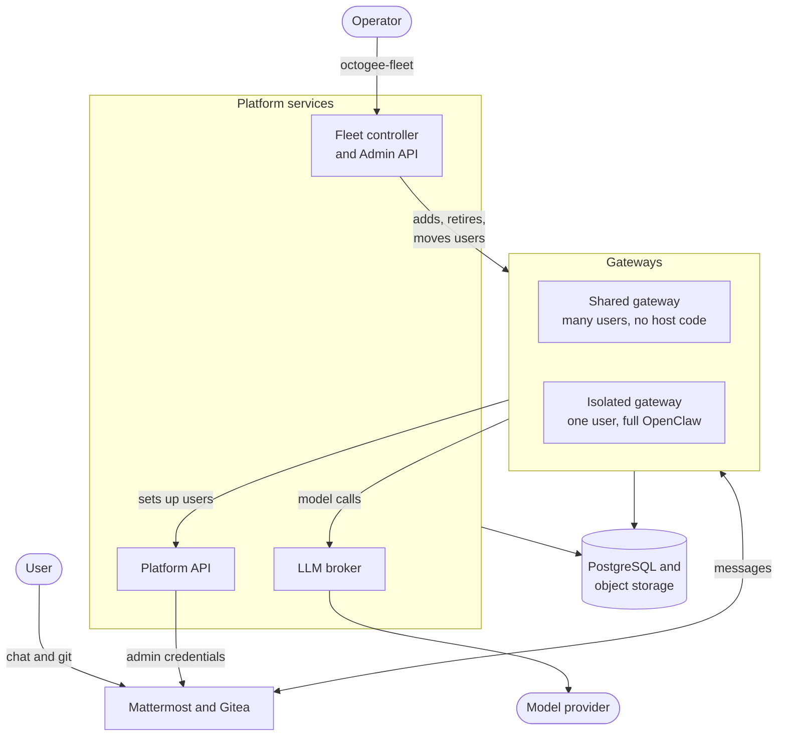

# Architecture

What runs, who talks to whom, where state lives, and how a product builds on
top. [Why octogee-cloud](why-octogee-cloud.md) covers the trust model this
serves, and [Known rough edges](rough-edges.md) lists what does not yet match
the picture below.

## The picture

## Services

| Service | Directory | What it does |
| --- | --- | --- |
| Fleet controller | `glm-controller/` | Owns the fleet: which gateways exist, which user is on which, and every move between them. Serves the Admin API that [`octogee-fleet`](https://github.com/octogee-ai/octogee-fleet) calls. Installs gateways with Helm, and creates the virtual machine when an isolated gateway runs on one. Writes an operations-journal entry for every change it makes. |
| Platform API | `octogee-api/` | Serves most HTTP routes. Its fleet broker holds the Mattermost and Gitea admin credentials and sets users up on behalf of a gateway. |
| LLM broker | `octogee-api/` (`src/llm-broker.ts`) | Holds the model provider keys and meters every call. An agent calls it with a credential the platform issued to that agent. Runs as its own deployment. |
| npm cache proxy | `octogee-api/` (`src/npm-cache-proxy.ts`) | An npm registry proxy with a cache. Runs as its own deployment. |
| Edge | `gateway-edge/` | One codebase, three roles. As a sidecar in each gateway pod it serves the user's workspace files and proxies the Mattermost WebSocket. As the gateway router it sends `/g/<gatewayId>/*` to that gateway's sidecar. As the Mattermost callback router it receives Mattermost's callbacks. |
| Provisioner | `scripts/entrypoints/fleet-controller.ts` | Runs inside the gateway pod. When a user is assigned to the gateway it creates their Mattermost account, team, channels and agent bot, and their Gitea organization and `workspace` repository, all through the platform API's fleet broker. |
| Gateway image | `infra/gateway/` | OpenClaw, the provisioner, and the platform's OpenClaw extensions under `infra/gateway/extensions/platform/`. [OpenClaw compatibility](openclaw-compatibility.md) lists the patches the OpenClaw build carries. |
| Isolated gateway VM image | `infra/desktop/` | The virtual machine image for an isolated gateway that runs on a VM, which adds a desktop. Google Cloud only today. |

`core/` and `shared/` are libraries the services share: platform state, the
secret store, chat and git host adapters, and types.

## Two kinds of gateway

A **shared gateway** is a Kubernetes pod from the `helm/octogee-gateway` chart,
under gVisor on a cloud cluster. Many users share its one OpenClaw process, so
their agents cannot run host code, and the gateway holds no credentials. Its
users work through Mattermost and Gitea.

An **isolated gateway** serves one user and runs full OpenClaw, host tools and
the Control UI included. It runs as a Kubernetes pod with its own service
account and home claim, or on a Google Cloud virtual machine, which adds a
desktop. A sizing profile chooses which.

A user's agents, channels, repositories, agent stores and schedules are records
the fleet controller owns, so it can move a user from one gateway to another.
Fences ensure one gateway serves the user at a time.

The controller acts only when an operator asks. It adds no gateway, places no
user and moves no user by itself. It does keep a gateway an operator created at
its desired state, for example by recreating a virtual machine after a
preemption.

## Where state lives

| State | Where |
| --- | --- |
| Users, gateways, assignments, operations journal, platform configuration | PostgreSQL, through `PlatformStateStore` in `core/src/platform-state/` |
| Secrets the platform creates | Encrypted rows in PostgreSQL under the root key, or Google Secret Manager |
| Each agent's store | Its own PostgreSQL schema. Database logins are per gateway. |
| Users' files and home checkpoints | S3-compatible object storage |
| Chat history | Mattermost's own database |
| Repositories | Gitea |

The platform needs no Firebase project. `scripts/__tests__/firebase-reach.spec.ts`
fails if a platform entrypoint loads the Firebase SDK.

## Who authenticates how

- **Operators** reach the Admin API with a Google sign-in or a token signed with
  the operator key.
- **Users** are known to the platform API by their Mattermost session or
  personal access token.
- **Services** authenticate to each other with Kubernetes service account
  tokens bound to the calling gateway, plus dedicated bearers and HMAC
  signatures. A broker releases a credential only after checking which gateway
  is asking and which user that gateway serves.

## Replaceable parts

[Requirements](requirements.md#plug-in-points) lists the parts an install can
replace. In code they are these interfaces:

| Part | Interface |
| --- | --- |
| Git host | `GitHost` in `core/src/git-host/types.ts` |
| Chat host | `ChannelHost` in `core/src/channel-host/types.ts` |
| Operator identity | `IdentityProvider` in `core/src/identity-provider.ts` |
| User identity | `UserIdentityProvider` in `core/src/user-identity-provider.ts` |
| Secret store | `SecretStore` in `core/src/secret-store-types.ts` |
| Encryption | `Encryptor` in `core/src/encryptor.ts` |

## How a product builds on top

The Octogee product is built on this repository, and anyone else can build one
the same way.

Each service has a composition root, `src/main.ts`, and the platform API has a
second, `src/llm-broker.ts`. The platform's own roots start the service with no
product. A product supplies its own roots, which call the same start function
with its additions:

| Service | Start function | What a product passes |
| --- | --- | --- |
| Fleet controller | `main(product)` in `glm-controller/src/index.ts` | `ControllerProduct`: admin routes, user lifecycle steps, and the automation the platform leaves out, such as placement, scaling and returning idle users |
| Platform API | `createPlatformApp({ product })` in `octogee-api/src/app.ts` | `ProductExtension`: routes, entitlements, notifications and the LLM broker's commercial rails |
| Edge | `createApp({ productRoutes })` in `gateway-edge/src/index.ts` | A route table |

`scripts/ops/overlay.mjs` assembles the build. It copies the platform tree,
adds the product's files beside the platform's, and refuses any product file
that would replace a platform file other than a composition root.

These interfaces are in-process and have no version yet. They change when the
platform needs them to, and a product pins a commit of this repository.
[Known rough edges](rough-edges.md) says what would fix that.
