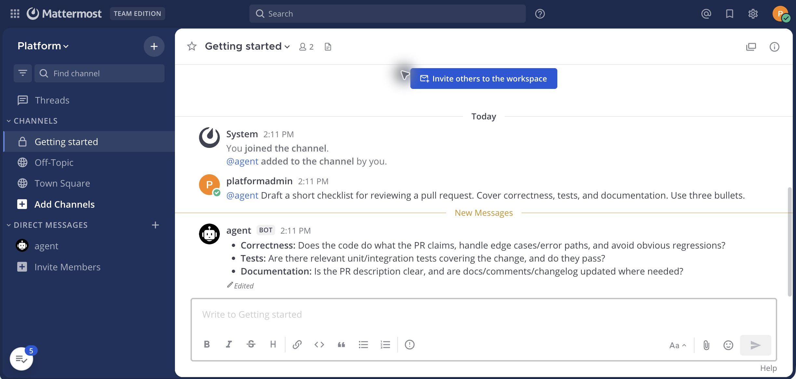
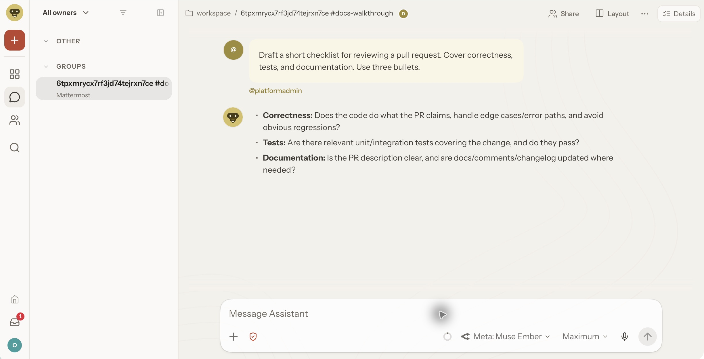

# Getting started

Install the local foundation, open Mattermost, and send a message to your
agent. The foundation runs one OpenClaw gateway, Mattermost for chat, and
Gitea for files and version history in Docker on your machine.

## Choose your installation

| Installation | Use it to | Guide |
| --- | --- | --- |
| Local foundation | Talk to an agent and explore chat and Git | Continue below |
| Full platform on kind | Manage users, shared gateways, and model access | [Full platform guide](kind.md) |
| Full platform on GKE or EKS | Manage a fleet with cloud databases and storage | [GKE guide](gke.md) or [EKS guide](eks.md) |
| Production deployment | Plan ingress, regional capacity, upgrades, and recovery | [Production guide](production.md) |
| Cloud foundation on GKE or EKS | Run chat, Git, and one gateway with managed databases and storage | [Cloud guide](running-in-the-cloud.md) |

Both local installations use kind, which runs Kubernetes in Docker. The
foundation installer is `install.sh`. The full platform installer is
`scripts/ops/kind-install.sh`; it adds the fleet controller, platform API, and
model broker. Each guide lists its requirements and verification status.

To contribute without installing a cluster, start with
[Contributing](../CONTRIBUTING.md).

## What you need to sign up for

The installer creates the chat, Git, database, and storage services. Bring a
model provider API key so the agent can reply.

### Model access

Choose a provider you already use, or create an API key with one below.
Provider billing and model availability apply to calls made by your agents.

| Provider | Export the key as | Installation |
| --- | --- | --- |
| [OpenAI](https://platform.openai.com/api-keys) | `OPENAI_API_KEY` | Foundation and full platform |
| [Anthropic](https://platform.claude.com/settings/keys) | `ANTHROPIC_API_KEY` | Foundation and full platform |
| [OpenRouter](https://openrouter.ai/keys) | `OPENROUTER_API_KEY` | Foundation and full platform |
| [Google Gemini](https://aistudio.google.com/apikey) | `GEMINI_API_KEY` | Foundation |

This walkthrough uses [Meta Muse Ember through OpenRouter](https://openrouter.ai/meta/muse-ember)
with maximum reasoning. Enter your OpenRouter key before running the installer:

```bash
read -rs OPENROUTER_API_KEY && export OPENROUTER_API_KEY
export AGENT_MODEL=openrouter/meta/muse-ember
export AGENT_THINKING=max
```

Paste the key and press Enter. The input stays hidden and the key stays out of
shell history. `AGENT_MODEL` selects the model and `AGENT_THINKING` selects its
reasoning level. For another provider, use its key from the table and its
OpenClaw model ID, or omit these two settings to use the installer's defaults.
The installer copies supported keys exported in that terminal into the cluster.
Export only the keys you want it to use.

For Gemini, review the provider's
[model pricing and data-use terms](https://aistudio.google.com/docs/pricing)
when choosing between free and paid access. The full platform's
[model provider guide](kind.md#model-provider-keys) explains its model selection.

### Cloud hosting

For Google Cloud or AWS, use a cloud account with billing enabled, permission
to create the resources in the [cloud guide](running-in-the-cloud.md), and a
domain whose DNS records you can manage. Supply an email address for
certificate notices.

Cloud charges cover the cluster, virtual machines, database, storage, and
networking while resources exist. Check your provider's pricing and set a
budget before installation. The cloud guide includes sizing and removal steps.

### To manage gateways with `octogee-fleet`

The [`octogee-fleet`](https://github.com/octogee-ai/octogee-fleet) command line
signs in with your Google account. Create an OAuth client in the same
Google Cloud project, with the type
**TVs and Limited Input devices**. This client type supports sign-in
from a command line, where `octogee-fleet` prints a code and you approve it in
a browser. On kind it signs in with a key the installer generates instead, so
it needs no OAuth client there.

Install it with Go. Go puts it in `$(go env GOPATH)/bin`, usually `~/go/bin`,
which has to be on your `PATH`:

```bash
go install github.com/octogee-ai/octogee-fleet@latest
```

## Install

Download the installer, review it, and run it with Bash. These commands work
from a terminal on macOS or Linux, or inside WSL2 on Windows:

```bash
curl -fsSLo install.sh https://raw.githubusercontent.com/octogee-ai/octogee-cloud/main/install.sh
# Review install.sh before running it.
bash install.sh --target=local
```

The installer checks your machine and gives instructions for missing tools.
It then shows what it will create and asks for confirmation. It checks out the
repository at `~/octogee-cloud` by default. Run the `deploy/` commands below
from that checkout:

```bash
cd ~/octogee-cloud
```

To check your machine without installing, or to run without questions:

```bash
bash install.sh --target=local --check-only
```

```bash
bash install.sh --target=local --yes --no-prompt
```

| Your machine | Where to run the installer |
| --- | --- |
| macOS | Any terminal, with Docker Desktop running |
| Linux, including Omarchy and other Arch systems | Any terminal, with Docker Engine running |
| Windows | Inside WSL2, not PowerShell or Git Bash |

[Requirements](requirements.md) lists the tools. The installer gives you the
install command for each one on your system.

### Windows

1. In PowerShell as Administrator, run `wsl --install`, then restart.
2. Install Docker Desktop. Under **Settings > Resources > WSL integration**,
   turn on your Ubuntu distribution.
3. Open Ubuntu and run the install command there.

Keep the checkout in your Linux home folder, which is the default. Files under
`/mnt/c` are slow and lose their permissions.

## Use it

The local install takes five to ten minutes the first time, mostly downloading
images. When it finishes:

1. Open <http://chat.localhost:8088>.
2. Sign in as `platformadmin`. Get the password from your checkout:

   ```bash
   ./deploy/local/credentials.sh
   ```

3. Send a direct message to `@agent`.

You can also invite `@agent` to a channel and mention it in a message:

[](images/mattermost-chat.png)

This conversation was captured on the GKE foundation installation. Click the
image to view it at full size.

The installer lists exported model keys before you confirm and copies them
into the cluster. To update the key or model, run the recipe again:

```bash
read -rs OPENROUTER_API_KEY && export OPENROUTER_API_KEY
export AGENT_MODEL=openrouter/meta/muse-ember
export AGENT_THINKING=max
./deploy/local/up.sh
```

Without `AGENT_MODEL`, the installer selects a default model from the first
available key in this order: Anthropic, OpenAI, Gemini, OpenRouter.

Git is at <http://git.localhost:8088> with the same username and password.

To open the OpenClaw Control UI, start a port-forward and go to
<http://localhost:18789>. The gateway token is in the output of
`credentials.sh`.

```bash
kubectl --kubeconfig ~/.kube/octogee-cloud-local -n octogee-cloud-local port-forward deploy/gateway 18789
```

Use another local port if `18789` is already in use, for example
`18790:18789`, and open `http://localhost:18790`. You can share that local link
in Mattermost with someone running the same port-forward. Each browser signs
in with the gateway token; keep the token out of chat messages and screenshots.

[](images/openclaw-control-ui.png)

The foundation Control UI, opened from a link in Mattermost through a local
port-forward to the GKE gateway. The fleet's isolated-gateway `/ui` command is
a separate flow described in the [full platform guide](kind.md).

Everything runs inside a kind cluster with its own kubeconfig at
`~/.kube/octogee-cloud-local`. The installer does not change your current
Kubernetes context. Only localhost can reach the ports.

Check the install at any time:

```bash
./deploy/local/check.sh
```

## Run the foundation in the cloud

[Running the foundation in the cloud](running-in-the-cloud.md) covers GKE and
EKS with managed PostgreSQL and object storage. It installs the same foundation
as the local install, not the full platform.

## Work on the code

[Contributing](../CONTRIBUTING.md) covers checkout setup, Node.js 24, package
checks, and pull requests. [AGENTS.md](../AGENTS.md) maps the packages and their
engineering conventions.

## Remove it

This deletes the local cluster and all of its data.

```bash
./deploy/local/down.sh
```
