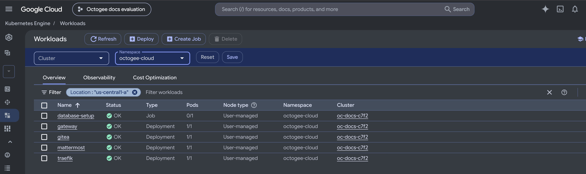
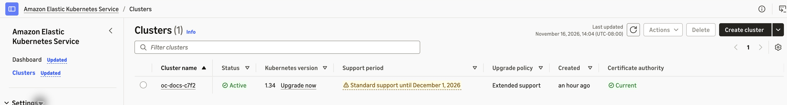

# Running the foundation in the cloud

Install one OpenClaw gateway, Mattermost, and Gitea on Google Kubernetes Engine
(GKE) or Amazon Elastic Kubernetes Service (EKS). The installer connects them
to managed PostgreSQL and object storage, then configures HTTPS for chat and Git.

Use `install.sh --target=gcp` for Google Cloud or `--target=aws` for AWS. These
are the cloud foundation installations. For user placement, shared gateways,
and the model broker, follow the full platform guides for
[kind](kind.md), [GKE](gke.md), or [EKS](eks.md).

## Tested installations

On November 16, 2026, disposable GKE and EKS installations passed the database,
object-storage, HTTPS, and gateway checks. On both, an operator signed in to
Mattermost and Gitea, created and read back a committed file, and received an
agent reply using Meta Muse Ember through OpenRouter with maximum reasoning.
The GKE run used the zonal evaluation settings below; EKS used the default
three-node configuration and Multi-AZ RDS. These foundation runs used
`a087072e46e9791a5394adfbdd8a2d947f3d7b49` with this guide's installer changes;
they are separate from the full-platform runs recorded in the GKE and EKS guides.

[](images/gke-workloads.png)

GKE: the foundation's four deployments are ready. `database-setup` is a completed
job. Click the image to enlarge it.

[](images/eks-cluster.png)

EKS: the cluster is active. Application readiness and the user flows above were
checked through Kubernetes and the public HTTPS endpoints.

## What gets created

| | Google Cloud | AWS |
| --- | --- | --- |
| Kubernetes | Regional GKE with private nodes, 3 to 9 nodes | EKS with private nodes, 2 to 5 nodes |
| PostgreSQL 16 | Cloud SQL, highly available, private address, encrypted connections only | RDS Multi-AZ, private, encrypted |
| Backups | Daily, with point-in-time recovery | Daily, kept for 7 days |
| Object storage | Cloud Storage | S3 |
| Outbound traffic | Cloud NAT | NAT gateway |
| Inbound traffic | Traefik behind a load balancer | Traefik behind a Network Load Balancer |
| TLS | cert-manager with Let's Encrypt | cert-manager with Let's Encrypt |

The databases have deletion protection on.

Mattermost, Gitea and the OpenClaw gateway have no managed equivalent on the
default path, so they run in your cluster. Their databases are on the managed
PostgreSQL, and their files are on your provider's persistent disks.

Mattermost Team Edition runs one replica and stops creating accounts at 250
activated users across the server. Bots do not count.

## Before you start

- The accounts in [What you need to sign up for](getting-started.md#what-you-need-to-sign-up-for).
- A cloud account with billing on and permission to create the resources above.
- A domain you control. Chat and Git use `chat.` and `git.` under it.
- An email address for certificate notices.
- The tools in [Requirements](requirements.md). The installer checks them.

These are billable resources that run until you remove them. Check your
provider's pricing first.

## Start with a single zone

The Google Cloud defaults use nodes across three zones and a highly available
database. For a disposable evaluation, select one zone and a smaller database:

```bash
export GCP_ZONE=us-central1-a SQL_AVAILABILITY=ZONAL SQL_TIER=db-custom-1-3840
```

This starts one node, scales to three, and uses a database without a standby.
The regional defaults distribute resources across zones for availability.
See Google's [zonal cluster guide](https://cloud.google.com/kubernetes-engine/docs/how-to/creating-a-zonal-cluster)
for the cluster configuration and [billing documentation](https://cloud.google.com/free/docs/free-cloud-features)
for credit eligibility and usage limits.

## Install on Google Cloud

Use a dedicated project for an evaluation so you can remove all its resources
together. Sign in and choose a globally unique project ID:

```bash
gcloud auth login
export GCP_PROJECT=your-evaluation-project
export GCP_REGION=us-central1
export CLUSTER_NAME=octogee-evaluation
gcloud projects create "${GCP_PROJECT}"
```

List the billing accounts you can use, then link the project to your chosen
account. Replace `YOUR-BILLING-ACCOUNT-ID` with its ID:

```bash
gcloud billing accounts list
gcloud billing projects link "${GCP_PROJECT}" --billing-account=YOUR-BILLING-ACCOUNT-ID
```

Set the domain and certificate-contact email, and export a
[model provider key](getting-started.md#model-access). Choose a subdomain
reserved for this installation:

```bash
export DOMAIN=evaluation.example.com ACME_EMAIL=ops@example.com
```

Download the installer, review it, and run it:

```bash
curl -fsSLo install.sh https://raw.githubusercontent.com/octogee-ai/octogee-cloud/main/install.sh
# Review install.sh before running it.
bash install.sh --target=gcp
```

The installer connects to GKE through its DNS endpoint using your Google Cloud
identity. Nodes keep private addresses. See Google's
[control-plane access guide](https://cloud.google.com/kubernetes-engine/docs/how-to/latest/network-isolation)
for the IAM permissions used by this connection.

## Install on AWS

Sign in first:

```bash
aws configure sso --profile octogee-evaluation
aws sso login --profile octogee-evaluation
export AWS_PROFILE=octogee-evaluation
```

Confirm the account, choose a resource name reserved for this installation,
and export a [model provider key](getting-started.md#model-access):

```bash
aws sts get-caller-identity
export AWS_REGION=us-east-1 CLUSTER_NAME=octogee-evaluation
export DOMAIN=evaluation.example.com ACME_EMAIL=ops@example.com
```

Download the installer, review it, and run it:

```bash
curl -fsSLo install.sh https://raw.githubusercontent.com/octogee-ai/octogee-cloud/main/install.sh
# Review install.sh before running it.
bash install.sh --target=aws
```

## Finish the install

An install takes 30 to 45 minutes. It ends by printing your load balancer's
address.

1. Create DNS records for `chat.` and `git.` under your domain, pointing at that
   address. Use an A record for an IP address and a CNAME for a hostname. In
   Cloudflare, select **DNS only** for these records so the installer can
   verify HTTPS directly against the load balancer.
2. Wait a few minutes for the certificates. Plain HTTP stays closed to the apps.
3. Run the checks, then get the admin password. Use `aws` in place of `gcp` on
   AWS. Run these from the checkout printed by the installer, with `DOMAIN`
   still set. A downloaded installer creates `~/octogee-cloud` by default.

   ```bash
   ./deploy/cloud/check.sh gcp
   ```

   ```bash
   ./deploy/cloud/credentials.sh gcp
   ```

4. Open `https://chat.your-domain` and sign in as `platformadmin`.

Any of `ANTHROPIC_API_KEY`, `OPENAI_API_KEY`, `GEMINI_API_KEY` or
`OPENROUTER_API_KEY` exported in your shell is copied into the cluster. The
installer lists them before you confirm. To add one later, set it and run the
same provider script again. It is safe to repeat.

To reproduce the model setup shown here, export `OPENROUTER_API_KEY`,
`AGENT_MODEL=openrouter/meta/muse-ember`, and `AGENT_THINKING=max` before running
the installer. See [model-key setup](getting-started.md#what-you-need-to-sign-up-for).

```bash
./deploy/cloud/gcp.sh
```

Everyone with a chat account can message the agent. Accounts are invitation
only. The installer keeps cluster credentials in their own file, such as
`~/.kube/octogee-cloud-gcp`, and leaves your current Kubernetes context alone.

## Sizing

Set these before you install.

| Setting | Default | Applies to |
| --- | --- | --- |
| `CLUSTER_NAME` | `octogee-cloud` | Both |
| `MACHINE_TYPE` | `e2-standard-4` | Google Cloud nodes |
| `SQL_TIER` | `db-custom-2-7680` | Cloud SQL |
| `SQL_AVAILABILITY` | `REGIONAL` | Cloud SQL. `ZONAL` has no standby |
| `GCP_ZONE` | Not set, so the cluster is regional | Google Cloud. Set it for a zonal cluster |
| `NODE_TYPE` | `m6i.xlarge` | AWS nodes |
| `DB_CLASS` | `db.m6i.large` | RDS |

## Other providers

A provider is one short script in `deploy/cloud/`. It creates a cluster, a
PostgreSQL 16 database with `vector`, `unaccent` and `pg_trgm`, and an
S3-compatible bucket, then calls `install_on_cluster`. `gcp.sh` is the example
to copy. These are not written yet:

| Provider | Kubernetes | PostgreSQL | Object storage |
| --- | --- | --- | --- |
| Azure | AKS | Azure Database for PostgreSQL | Azure Blob has no S3 API, so use an S3-compatible store elsewhere |
| DigitalOcean | DOKS | Managed PostgreSQL | Spaces |

## Remove a disposable installation

These steps delete the installation and its data. Use the same project,
profile, region, and `CLUSTER_NAME` you chose when installing. Remove the two
DNS records after cleanup so they no longer point to released addresses.

### Google Cloud

For the dedicated evaluation project created above, delete the project:

```bash
gcloud projects delete "${GCP_PROJECT}"
```

This schedules the project and its resources for deletion. Use this command
only for a project dedicated to the installation. Review its resources in the
Google Cloud console before confirming deletion.

### AWS

Keep `AWS_PROFILE`, `AWS_REGION`, and `CLUSTER_NAME` exported in this terminal.
First remove the Kubernetes namespace and wait for its load balancer and
persistent volumes to be released, following the
[AWS cluster deletion guidance](https://docs.aws.amazon.com/eks/latest/userguide/delete-cluster.html):

```bash
kubectl --kubeconfig ~/.kube/octogee-cloud-aws delete namespace octogee-cloud --wait=true --timeout=10m
```

Remove the disposable database without retaining a final snapshot:

```bash
aws rds modify-db-instance --db-instance-identifier "${CLUSTER_NAME}" --no-deletion-protection --apply-immediately
aws rds wait db-instance-available --db-instance-identifier "${CLUSTER_NAME}"
aws rds delete-db-instance --db-instance-identifier "${CLUSTER_NAME}" --skip-final-snapshot
aws rds wait db-instance-deleted --db-instance-identifier "${CLUSTER_NAME}"
```

Remove the database's subnet group and security group before deleting the
cluster's network:

```bash
VPC_ID=$(aws eks describe-cluster --name "${CLUSTER_NAME}" --query cluster.resourcesVpcConfig.vpcId --output text)
DB_SECURITY_GROUP=$(aws ec2 describe-security-groups --filters "Name=vpc-id,Values=${VPC_ID}" "Name=group-name,Values=${CLUSTER_NAME}-database" --query 'SecurityGroups[0].GroupId' --output text)
aws rds delete-db-subnet-group --db-subnet-group-name "${CLUSTER_NAME}"
aws ec2 delete-security-group --group-id "${DB_SECURITY_GROUP}"
eksctl delete cluster --name "${CLUSTER_NAME}" --region "${AWS_REGION}" --wait
```

Remove the bucket and the storage user's keys and policy:

```bash
ACCOUNT_ID=$(aws sts get-caller-identity --query Account --output text)
aws s3 rb "s3://${CLUSTER_NAME}-${ACCOUNT_ID}" --force
aws iam list-access-keys --user-name "${CLUSTER_NAME}-files" --query 'AccessKeyMetadata[].AccessKeyId' --output text
```

For each access key ID printed above, run:

```bash
aws iam delete-access-key --user-name "${CLUSTER_NAME}-files" --access-key-id YOUR-ACCESS-KEY-ID
```

Then remove the policy and user:

```bash
aws iam delete-user-policy --user-name "${CLUSTER_NAME}-files" --policy-name bucket
aws iam delete-user --user-name "${CLUSTER_NAME}-files"
```

Check the AWS console for remaining resources with your installation's name,
including volumes, load balancers, snapshots, and CloudFormation stacks.
